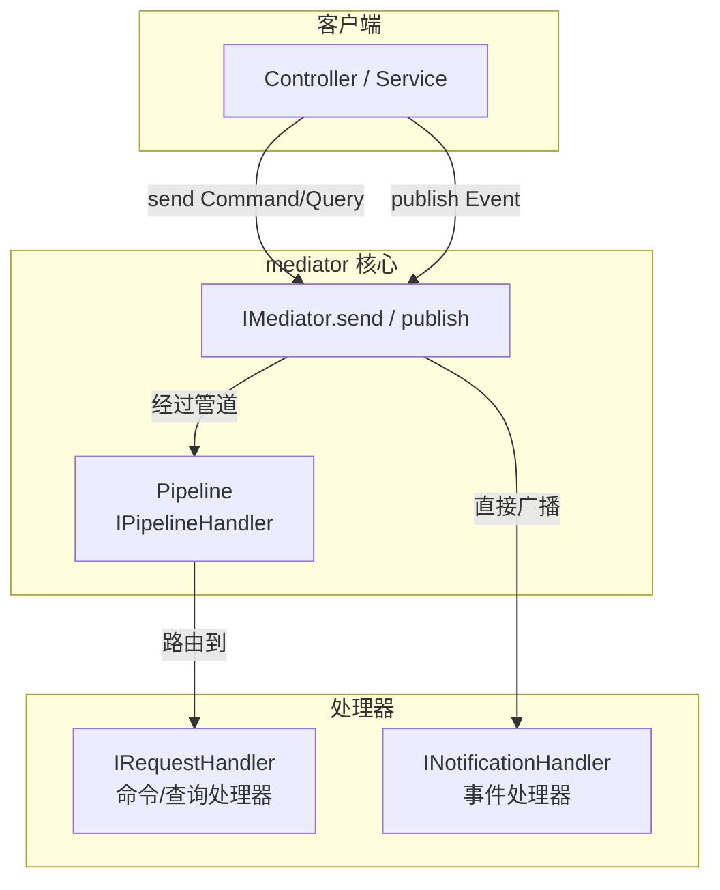

# soulsoft_mediator

**中介者模式库，支持请求/响应分发、通知广播与管道行为扩展。**

## 关于

soulsoft.mediator 实现了中介者模式，提供 `IMediator` 统一入口，通过 `ISender` 分发请求（Command/Query）并路由到唯一的 `IRequestHandler`，通过 `IPublisher` 广播事件（Notification）到多个 `INotificationHandler`。支持通过 `IPipelineHandler` 注册管道行为，实现 AOP 式横切关注点（日志、事务、校验等）。

### 特性

| 特性 | 描述 |
|------|------|
| 📨 **请求/响应分发** | `ISender.send<TRequest, TResponse>()` 将请求路由到唯一的 `IRequestHandler`，支持泛型返回值 |
| 📢 **通知广播** | `IPublisher.publish<TNotification>()` 将事件广播到所有已注册的 `INotificationHandler` |
| 🔗 **管道行为** | `IPipelineHandler` 支持多级拦截，按注册顺序构建执行管道，实现日志、事务、异常处理等 AOP 场景 |
| 🔍 **反射自动注册** | `MediatorBuilder.registerServices(PackageInfo)` 自动扫描包内所有 Handler 并注册，无需逐一声明 |
| 💉 **依赖注入集成** | `ServiceCollection.addMediator()` 一行注册，链式调用配置管道和 Handler |

## 如何使用

### 命令与查询（Request/Response）

定义请求和处理器，通过 `IMediator.send()` 分发：

```cj
import std.reflect.*
import soulsoft_mediator.*
import soulsoft_extensions_injection.*

// 定义请求（Unit 表示无返回值的命令；换成具体类型即为查询）
public class CreateUserCommand <: IRequest<Unit> {
    public CreateUserCommand(public let age: Int64) {}
}

// 定义处理器
public class CreateUserCommandHandler <: IRequestHandler<CreateUserCommand, Unit> {
    public func handle(request: CreateUserCommand): Unit {
        println("创建用户，年龄：${request.age}")
    }
}

main(): Int64 {
    let services = ServiceCollection()
    services.addMediator()
        .registerServices(PackageInfo.get("your.package.name"))
    let provider = services.build()

    try (scope = provider.getOrThrow<IServiceScopeFactory>().createScope()) {
        let mediator = scope.services.getOrThrow<IMediator>()
        mediator.send(CreateUserCommand(20))
    }
    return 0
}
```

### 通知（Notification）

通知没有返回值，一个通知可触发多个处理器，且不经过管道：

```cj
import std.reflect.*
import soulsoft_mediator.*
import soulsoft_extensions_injection.*

public class UserCreatedEvent <: INotification {}

public class SendEmailHandler <: INotificationHandler<UserCreatedEvent> {
    public func handle(notification: UserCreatedEvent): Unit {
        println("发送欢迎邮件")
    }
}

public class WriteAuditLogHandler <: INotificationHandler<UserCreatedEvent> {
    public func handle(notification: UserCreatedEvent): Unit {
        println("写入审计日志")
    }
}

main(): Int64 {
    let services = ServiceCollection()
    services.addMediator()
        .registerServices(PackageInfo.get("your.package.name"))
    let provider = services.build()

    try (scope = provider.getOrThrow<IServiceScopeFactory>().createScope()) {
        let mediator = scope.services.getOrThrow<IMediator>()
        // 两个 Handler 均会被调用
        mediator.publish(UserCreatedEvent())
    }
    return 0
}
```

### 管道行为（Pipeline）

管道按注册顺序包裹请求处理器，先注册的在外层（最先执行、最后返回）：

```cj
import soulsoft_mediator.*
import soulsoft_extensions_injection.*

// 定义切面：日志记录
public class LoggingBehavior <: IPipelineHandler {
    public func handle(request: Any, next: RequestDelegate): Any {
        println("请求开始")
        let response = next()
        println("请求结束")
        return response
    }
}

// 定义切面：异常处理
public class ExceptionBehavior <: IPipelineHandler {
    public func handle(request: Any, next: RequestDelegate): Any {
        try {
            return next()
        } catch (e: Exception) {
            println("捕获异常：${e.message}")
            return ()
        }
    }
}

main(): Int64 {
    let services = ServiceCollection()
    services.addMediator()
        .addPipelineHandler<LoggingBehavior>()
        .addPipelineHandler<ExceptionBehavior>()
        .registerServices(PackageInfo.get("your.package.name"))
    let provider = services.build()

    try (scope = provider.getOrThrow<IServiceScopeFactory>().createScope()) {
        let mediator = scope.services.getOrThrow<IMediator>()
        mediator.send(CreateUserCommand(20))
    }
    return 0
}
```

## 工作流程



## API 参考

### IMediator

组合接口，继承 `ISender` 和 `IPublisher`，统一分发入口。

### ISender

| 方法 | 说明 |
|------|------|
| `send<TRequest, TResponse>(command: TRequest): TResponse` | 分发请求到唯一的 `IRequestHandler`，经过已注册的管道 |

### IPublisher

| 方法 | 说明 |
|------|------|
| `publish<TNotification>(notification: TNotification): Unit` | 广播通知到所有 `INotificationHandler`，不经过管道 |

### IRequestHandler\<TRequest, TResponse\>

| 方法 | 说明 |
|------|------|
| `handle(request: TRequest): TResponse` | 处理请求并返回结果 |

### INotificationHandler\<TNotification\>

| 方法 | 说明 |
|------|------|
| `handle(notification: TNotification): Unit` | 处理通知事件 |

### IPipelineHandler

| 方法 | 说明 |
|------|------|
| `handle(request: Any, next: RequestDelegate): Any` | 实现横切逻辑，调用 `next()` 传递控制权到下一个管道或处理器 |

### MediatorBuilder

| 方法 | 说明 |
|------|------|
| `addPipelineHandler<T>(): MediatorBuilder` | 注册管道行为，按调用顺序构建管道（先注册先执行） |
| `registerServices(packageInfo: PackageInfo): MediatorBuilder` | 扫描指定包内所有 Handler 并自动注册到 DI 容器 |

## 相关包

- `soulsoft_extensions_injection` - 依赖注入

## 反馈与贡献

本项目由杭州颉创科技有限公司开发，以 MIT 许可证开源发布。欢迎在 [GitCode](https://gitcode.com/soulsoft) 提交错误报告和贡献代码。
